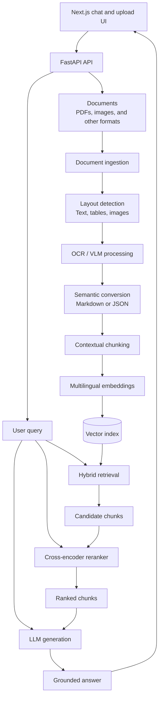

<p align="center">
  
</p>

<h1 align="center">FORGE Factory Operations Retrieval &amp; Generation Engine</h1>

<p align="center">
  <strong>Multimodal factory document intelligence for grounded, traceable answers.</strong><br />
  Denso Factory Hackathon 2026 · Challenge A3
</p>

> **Dataset disclosure:** The supplied factory data-preparation/supply pack is **AI-generated synthetic data** for demonstration and evaluation only. It contains no official factory standard, confidential information, or production record.

FORGE is a multi-format document understanding and retrieval-augmented generation (RAG) system. It is designed to process PDFs, images, tables, and bilingual documents using OCR/VLM, layout-aware extraction, multilingual embeddings, and vector search - enabling accurate chatbot responses without manual preprocessing.

## Pain point

Factory operations knowledge is often spread across PDFs, scanned images, tables, and bilingual documents. Each format can require different preprocessing, including OCR, layout reconstruction, table extraction, and language handling, before an AI system can search and use the content. When that work is manual or inconsistent, valuable information takes longer to access and chatbot answers can miss or misread important context. This makes it difficult to build one dependable retrieval workflow for the documents teams already use.

## Solution architecture

FORGE uses a multimodal retrieval-augmented generation pipeline. The indexing path converts mixed-format documents into searchable, context-preserving representations. The answering path combines a user's question with the most relevant content and passes both to an LLM for a grounded response.



### Pipeline stages

1. **Document ingestion** accepts PDFs, images, and other supported formats and records the source document and its metadata.
2. **Layout detection** identifies regions such as text blocks, tables, figures, and images so the document's structure is available to later stages.
3. **OCR and VLM processing** extracts text from each region and creates descriptions for visual elements that contain useful information.
4. **Semantic conversion** transforms the extracted content into Markdown or JSON while preserving headings, reading order, table relationships, page references, and other layout context.
5. **Contextual chunking** uses Docling's `HybridChunker` to apply document-aware and tokenizer-aware chunking. It keeps headings and captions with their content, merges compatible peer chunks, and can repeat table headers when a table spans multiple chunks.
6. **Embedding** creates multilingual vector representations for each chunk and stores them with the original text and source metadata.
7. **Hybrid retrieval** combines keyword matching with vector similarity to produce a broad candidate set that includes both exact operational terms and semantically related content.
8. **Cross-encoder reranking** scores each query and candidate-chunk pair together, then reorders the candidates so the most relevant context reaches the generator. The reranker runs on the smaller candidate set to balance quality and latency.
9. **Generation** sends the user query and reranked context to an LLM, which produces a grounded answer and can return the source references associated with the retrieved chunks.

### Design principles

- **Layout-aware:** document structure is treated as part of the meaning, especially for tables, forms, and multi-column pages.
- **Multimodal:** the pipeline handles information found in text, images, and visual document elements.
- **Language-aware:** multilingual processing and embeddings support bilingual operational content.
- **Context-preserving:** tokenizer-aware chunking keeps related content together so retrieval does not lose the relationships created by the original layout.
- **Traceable:** each chunk retains source metadata so generated answers can be checked against the original document.

## Target deliverables

- Multi-format document ingestion pipeline
- RAG chatbot demonstration
- Retrieval, answer quality, and latency report
- Evaluation dashboard comparing a naive baseline with FORG

## Technology stack

FORGE is designed for direct-host deployment. The application can run as native Python and Node.js processes or use managed services, so Docker is not required.

- **Frontend:** Next.js App Router, React, and TypeScript for the chat and document upload experience. Tailwind CSS provides the visual system, with accessible components owned by the application. [Next.js](https://nextjs.org/docs/app)
- **Backend API:** Python, FastAPI, and Pydantic for typed document, query, and response contracts. [FastAPI](https://fastapi.tiangolo.com/)
- **Document processing:** Docling for PDF conversion, layout detection, reading order, table extraction, OCR, and Markdown or JSON export. [Docling](https://docling.org/)
- **OCR and vision:** Docling OCR for scanned text, with a vision-language model adapter for complex visual regions and image descriptions.
- **Canonical representation:** A custom Pydantic schema that preserves pages, headings, regions, tables, languages, coordinates, and source references.
- **Pipeline orchestration:** LlamaIndex for optional ingestion and retrieval plumbing. The layout-aware document schema, chunker, and retrieval fusion logic remain FORGE-owned code. [LlamaIndex ingestion pipeline](https://docs.llamaindex.ai/en/v0.10.17/module_guides/loading/ingestion_pipeline/root.html)
- **Knowledge graph:** Kùzu 0.11.3 as the embedded graph database for typed source, chunk, and concept nodes; FastAPI exposes provenance-aware graph snapshots and the Next.js Graph workspace renders live neighborhoods.
- **Chunking:** Docling's `HybridChunker`, using an offline deterministic tokenizer for the demo and optionally the same tokenizer as the embedding model in production. Its `contextualize()` output is the text sent to embedding and retrieval. [Docling chunking](https://docling-project.github.io/docling/concepts/chunking/)
- **Embeddings:** BGE-M3 as the default multilingual embedding model for self-hosted deployments, with a managed multilingual model as an alternative. [BGE-M3](https://bge-model.com/bge/bge_m3.html)
- **Vector search:** Qdrant with dense and sparse vectors, metadata filtering, and reciprocal rank fusion for hybrid candidate retrieval. [Qdrant hybrid search](https://qdrant.tech/documentation/search/text-search/hybrid-search/)
- **Reranking:** `BAAI/bge-reranker-v2-m3` through Sentence Transformers' `CrossEncoder` API to rerank the top candidate chunks with multilingual query-passage scoring. [Model card](https://huggingface.co/BAAI/bge-reranker-v2-m3), [CrossEncoder usage](https://www.sbert.net/docs/cross_encoder/usage/usage.html)
- **Metadata database:** PostgreSQL for document records, processing status, user settings, evaluation data, and audit information.
- **File storage:** S3-compatible object storage for original files, page images, and processed Markdown or JSON artifacts. MinIO can be used for local development.
- **Background processing:** A Python worker with Redis-backed job coordination for long-running ingestion and re-indexing tasks.
- **Generation:** Gemini 2.5 Flash-Lite through Google's `google-genai` SDK. It is the default low-cost/free-tier provider for the demo; the provider boundary keeps a later managed or self-hosted replacement straightforward. [Gemini API](https://ai.google.dev/gemini-api/docs/libraries)
- **Local development and deployment:** `uv` for Python dependencies, `pnpm` for the Next.js application, and native process managers or managed services instead of Docker.

### Stack decisions

The first implementation uses Docling's `HybridChunker`, Qdrant for hybrid candidate retrieval, a cross-encoder for reranking, and Next.js for the user interface. PostgreSQL, object storage, and a durable worker queue remain the next operational layer; the current production query path keeps those boundaries replaceable rather than pretending an in-process upload registry is durable metadata storage. LlamaIndex should remain an integration layer rather than the owner of document structure or chunking logic.
Kùzu is the graph data layer for the Graph workspace. Query orchestration remains a direct retrieve → rerank → answer path, while graph traversal is exposed through the FastAPI graph contract.

### Current implementation

The repository now contains a working, dependency-light demo slice for the full query path:

- `apps/web` is a Next.js chat interface with quick demo prompts, upload feedback, citations, retrieval trace details, loading states, and an explicit abstention state.
- `services/api` exposes typed FastAPI contracts for health, document inventory, uploads, and query responses. The query response always carries `chunk_id`, source, page/region metadata, and retrieval trace fields.
- The supplied Denso starter pack is converted from its 17 manifest files at runtime: all PDFs, PNG/JPG images, XLSX workbooks, and the CSV catalog go through Docling and `HybridChunker`. The QA JSONL files are evaluation assets only; they are not indexed. The current pack produces 49 real chunks with table and image regions preserved.
- Every source-derived chunk carries its repo-relative source path, chunk ID, page set, semantic region label, region type, Docling item refs, and layout bounding boxes with coordinate origin. Citations return the same provenance, including table refs, picture refs, and “page unavailable” when a format such as CSV has no page coordinate.
- A content-addressed local cache under `data/.forge-cache/` makes repeat starts fast and invalidates when a source file, tokenizer selection, or chunk-size setting changes. The default `local-whitespace` tokenizer avoids an unnecessary model download for the live demo; production can set `FORGE_CHUNK_TOKENIZER=BAAI/bge-m3` for embedding-aligned chunk boundaries.
- Uploads are size- and extension-validated and stored outside the source tree. Demo mode acknowledges uploads without changing its deterministic index; production mode sends uploaded files through Docling conversion, `HybridChunker`, embedding, Qdrant upsert, and metadata registration.

This separation is intentional: the demo uses the same real source conversion and provenance contract as production, while keeping Qdrant, metadata storage, and model providers replaceable at the infrastructure boundary. The evaluation QA files remain outside the retrieval corpus so test answers cannot leak into runtime retrieval.

The API now requires Docling for the default demo. Install the service dependencies from the repository root with `uv --cache-dir .uv-cache sync --project services/api` or, for an existing virtual environment, `uv --cache-dir .uv-cache pip install --python services/api/.venv/Scripts/python.exe -r services/api/requirements-docling.txt`. It follows Docling's `DocumentConverter` → `HybridChunker.chunk()` → `HybridChunker.contextualize()` flow. The default local tokenizer does not download Hugging Face weights; set `FORGE_CHUNK_TOKENIZER` to a locally available embedding tokenizer when model-aligned chunk boundaries are required.

## Production runtime (opt-in)

Production mode is explicit so a missing model, Qdrant service, or LLM key cannot silently downgrade the application to a weaker retrieval path. It does not require Docker: use a managed Qdrant Cloud collection or another reachable Qdrant deployment, then run the API as a native Python process.

Install the production adapters:

```powershell
Set-Location services/api
uv --cache-dir ../../.uv-cache pip install --python .venv/Scripts/python.exe -r requirements-production.txt
```

The first production run downloads the BGE-M3 embedding weights and the multilingual cross-encoder weights into the Hugging Face cache. Pre-warm those models in the deployment image or CI job so the first user request does not pay the download cost. Override `FORGE_DENSE_MODEL` or `FORGE_RERANKER_MODEL` only when the replacement model is compatible with the configured retrieval contract.

Configure the service in the same PowerShell session. Keep keys in environment variables or a secret manager; do not commit them:

```powershell
$env:FORGE_RUNTIME_MODE = "production"
$env:FORGE_QDRANT_URL = "https://<your-qdrant-endpoint>:6333"
$env:FORGE_QDRANT_API_KEY = "<your-qdrant-api-key>"
$env:GEMINI_API_KEY = "<your-gemini-api-key>"
```

The default model is `gemini-2.5-flash-lite`. Create the key in [Google AI Studio](https://ai.google.dev/gemini-api/docs/api-key), keep it server-side, and confirm the current [Gemini free-tier limits](https://ai.google.dev/gemini-api/docs/pricing) before a public demo.

Index the supplied synthetic starter pack once, then start the API. The indexing command now converts the real source files before embedding them; it does not read the QA anchors:

```powershell
uv --cache-dir ../../.uv-cache run python -m app.index_demo
uv --cache-dir ../../.uv-cache run uvicorn app.main:app --reload --port 8000
```

The production query path is:

`question → BGE-M3 dense query + Qdrant BM25 sparse query → Qdrant RRF fusion → multilingual cross-encoder reranking → evidence threshold → Gemini answer`

Uploaded PDFs, images, XLSX, and CSV files are converted through Docling and indexed synchronously in this first production slice. The same normalized provenance fields are written into Qdrant payloads. For a multi-user deployment, move that conversion and indexing call behind a durable worker queue, persist document/job metadata in PostgreSQL, and store originals and artifacts in object storage before enabling unrestricted uploads.


## Evaluation framework

A reliable RAG system needs to be evaluated at every important boundary, from document extraction to the final answer. FORGE uses three pillars: a golden dataset, a consistent metric set, and repeatable evaluation tooling.

### 1. The golden dataset

The golden dataset is the reference set used for regression testing and model comparison. Each test case should include:

- A stable case ID and the source document ID
- The question and its language
- The expected answer or the facts an answer must contain
- The relevant page, region, table, or chunk IDs that support the answer
- The document format and question type, such as text lookup, table reasoning, visual understanding, or multi-step retrieval
- An answerability label for questions where the system should abstain because the evidence is missing
- Expected citation or source-reference requirements

The dataset should contain representative PDFs, scans, tables, images, and bilingual documents. Gold evidence is essential because a correct final answer can hide a retrieval failure, while a wrong answer can come from either missing context or poor generation.

#### Fast bootstrap workflow

Creating 50 to 200 high-quality cases by hand is slow, so FORGE can bootstrap candidate cases from the processed corpus:

1. Ask an LLM to generate questions from Docling Markdown or JSON chunks.
2. Require each candidate to include the question, reference answer, language, answerability label, and exact supporting `chunk_id` values.
3. Stratify the candidates by document format, language, question type, and difficulty.
4. Run a time-boxed human calibration pass on a representative sample. Correct accepted cases, reject unsupported cases, and expand the review if the error rate is high.
5. Promote only verified cases to the golden dataset.

This gives the team a fast starting point while keeping the final labels grounded in the source documents. The pitch should describe this accurately as LLM-assisted dataset generation followed by human verification.

### 2. The metrics

#### Retrieval and reranking

- **Hit@k and Recall@k:** whether the supporting evidence appears in the retrieved candidates.
- **MRR and nDCG@k:** whether relevant evidence is ranked near the top.
- **Context precision:** how much of the retrieved context is useful rather than noise.
- **Context recall:** how much of the evidence needed to answer the question was retrieved.
- **Reranker lift:** the change in ranking quality from hybrid retrieval alone to hybrid retrieval followed by cross-encoder reranking.

#### Generation

- **Faithfulness:** whether the answer is supported by the retrieved evidence.
- **Answer correctness:** whether the answer agrees with the reference answer and required facts.
- **Answer relevancy and completeness:** whether it addresses the question directly without omitting important parts.
- **Citation correctness and coverage:** whether cited sources support the claims and cover the answer's main assertions.
- **Abstention accuracy:** whether the system declines to answer when the corpus does not contain sufficient evidence.

#### Pipeline and operations

- OCR quality on a labeled sample, using character or word error rate where ground-truth transcriptions exist.
- Table and layout extraction accuracy for representative documents.
- Ingestion success rate and reprocessing failure rate.
- Query latency, ingestion throughput, and cost per document or query.

#### Specialized evaluation

- **Table extraction:** normalize the ground-truth and predicted tables into a consistent Markdown representation, then compare cell content and structure using normalized edit distance or fuzzy matching. Report both a similarity score and cell-level precision, recall, and F1 where possible.
- **VLM descriptions:** evaluate a labeled sample with a rubric-based judge. Score whether the description captures the main objects, labels, values, and relationships in the visual region on a 1 to 5 scale.
- **Abstention:** label every case as answerable or unanswerable. An answerable question is successful only when the system gives a correct, supported answer. An unanswerable question is successful only when the system explicitly abstains. Report answerability F1 for the binary decision, unanswerable recall for correct abstentions, and end-to-end answer success across all cases.

The four abstention outcomes are:

- Answerable question with a correct supported answer: `1`
- Answerable question answered with an abstention: `0`
- Unanswerable question with an explicit abstention: `1`
- Unanswerable question answered with an unsupported claim: `0`

If the pitch uses the label **Abstention F1**, define it as the F1 score for the unanswerable class and show the underlying confusion matrix. The four-case score above is an end-to-end correctness score, not an F1 score by itself.

#### Cost accounting

Record usage for every ingestion and query run so costs can be calculated from actual model and infrastructure consumption:

- **Document cost:** OCR and VLM calls, output tokens, embedding tokens, storage, and reprocessing.
- **Query cost:** query embedding, reranking, LLM input and output tokens, and any citation or evaluation calls.
- **Operational cost:** compute time, memory or GPU usage, and shared-service costs allocated per document or query.

Store the model name, token or image counts, unit prices, and run ID with each measurement. Report both average and p95 cost where the workload varies. Values in the pitch dashboard must come from these logs rather than illustrative estimates.

### 3. The tools

- **Ragas** for automated RAG metrics such as context precision, context recall, faithfulness, response relevancy, and multimodal evaluation. [Ragas metrics](https://docs.ragas.io/en/latest/concepts/metrics/available_metrics/)
- **pytest** for deterministic tests covering parsing, schema validation, chunk boundaries, metadata preservation, retrieval fixtures, and API contracts. [pytest parametrization](https://docs.pytest.org/en/stable/how-to/parametrize.html)
- **RapidFuzz** or an equivalent text-similarity library for normalized table comparisons.
- **Human review** for a sampled set of answers, especially table, image, bilingual, multi-step, and abstention cases. Automated judge scores should be calibrated against these reviews.

Every evaluation run should record the corpus version, parser, chunker, tokenizer, embedding model, reranker, LLM, prompt version, retrieval settings, and timestamp. This makes changes measurable and prevents improvements in one component from being mistaken for improvements in the whole system.

### Baseline comparison

Run both systems on the same corpus and golden dataset:

- **Naive baseline:** fixed-size chunking, dense-only retrieval, no cross-encoder reranking, and the same generation model where possible.
- **FORGE:** Docling `HybridChunker`, hybrid dense and sparse retrieval, cross-encoder reranking, and the same generation model.

The results dashboard should show measured values and the change from baseline. Until the experiment is run, use `TBD` rather than presenting sample numbers as results.

| Category | Metric | Naive baseline | FORGE | Change |
|---|---|---:|---:|---:|
| Retrieval | Context recall | TBD | TBD | TBD |
| Retrieval | Reranker lift, MRR | N/A | TBD | TBD |
| Generation | Faithfulness | TBD | TBD | TBD |
| Generation | Answerability F1 | TBD | TBD | TBD |
| Operations | p95 latency | TBD | TBD | TBD |
| Operations | Cost per query | TBD | TBD | TBD |

## Judge questions

The pitch should explain the hardest engineering decisions through system behavior and measured trade-offs, rather than walking through source code.

### What was the hardest engineering decision?

The hardest decision was preserving document structure across the entire pipeline. Flattening everything into plain text would simplify ingestion, but it would lose table relationships, reading order, headings, and visual context. FORGE keeps the structured Docling representation through chunking, retrieves candidates with both semantic and lexical search, and uses a cross-encoder to select the strongest evidence before generation.

### Why not put the whole document into a large context window?

We considered full-document prompting for individual files. It repeats the entire document for every question, which increases latency and cost and becomes impractical as the document library grows. FORGE retrieves only the evidence needed for the question, reranks it for precision, and preserves the page or region reference needed to verify the answer. We will support this comparison with measured latency and cost from the evaluation dashboard instead of quoting unverified estimates.

### How do you handle bilingual documents?

We use BGE-M3 for multilingual embeddings so related English and Vietnamese passages can be compared in the same retrieval space. The system keeps the original language and source metadata, while the retrieval layer can match an English question to Vietnamese evidence, or the reverse, without requiring a separate index or a translation step for the first pass. Cross-language cases are part of the golden dataset.

### What happens when a document is a poor-quality scan?

The pipeline uses OCR for scanned text and can route low-confidence or visually complex regions through the VLM adapter. Each extracted result keeps its page and region reference, and low-confidence cases can enter a human-review queue in the metadata database. If the evidence remains insufficient, the answer path should abstain rather than generate a plausible guess.

### How do you know the answer is grounded?

Every answer is evaluated against the retrieved evidence and the gold source regions in the dataset. We measure retrieval recall and ranking quality before generation, then faithfulness, answer correctness, citation coverage, and abstention behavior after generation. The demo makes this visible by opening the exact evidence used for the answer.
