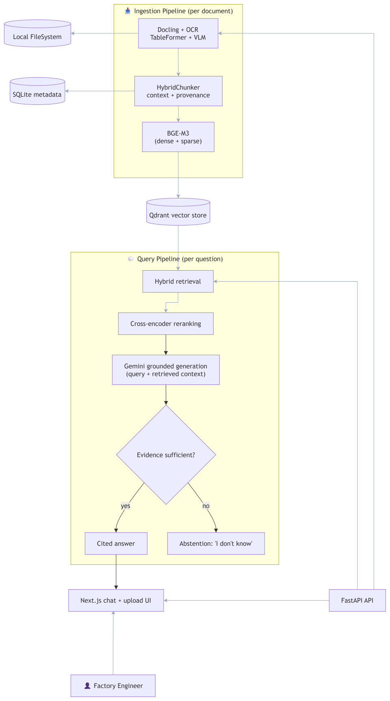

  

<h1 align="center">FORGE Factory Operations Retrieval &amp; Generation Engine</h1>

  <strong>Multimodal factory document intelligence for grounded, traceable answers.</strong> 
  Denso Factory Hackathon 2026 · Challenge A3

> **Dataset disclosure:** The supplied factory data-preparation/supply pack is **AI-generated synthetic data** for demonstration and evaluation only. It contains no official factory standard, confidential information, or production record.

FORGE is a multi-format document understanding and retrieval-augmented generation (RAG) system. It is designed to process PDFs, images, tables, and bilingual documents using OCR/VLM, layout-aware extraction, multilingual embeddings, and vector search - enabling accurate chatbot responses without manual preprocessing.

## Pain point

Factory operations knowledge is often spread across PDFs, scanned images, tables, and bilingual documents. Each format can require different preprocessing, including OCR, layout reconstruction, table extraction, and language handling, before an AI system can search and use the content. When that work is manual or inconsistent, valuable information takes longer to access and chatbot answers can miss or misread important context. This makes it difficult to build one dependable retrieval workflow for the documents teams already use.

## Data Curation

Input data is the foundation for validating the RAG system. To test every capability of the pipeline, the input corpus is curated from a diverse collection of open-source datasets, all licensed under permissive terms (Creative Commons, CC0, MIT, Apache 2.0, or public domain).

### Format Coverage

The corpus exercises every claimed input path through two linked sets:

**Coverage links**

- **Digital PDF** → Docling text extraction and reading order
- **Scanned PDF** → OCR and noisy-layout detection
- **PDF with complex tables** → TableFormer and table-aware chunking
- **PDF with charts or diagrams** → VLM adapter and image-block extraction
- **Bilingual PDF (VN/JP, VN/EN)** → BGE-M3 cross-lingual retrieval
- **Excel / CSV / XLSX** → structured parsing and row/column chunking
- **Standalone images** → VLM description and image understanding
- **Mixed PDF (text + table + image)** → structure parsing and multi-block handling

### Difficulty Tiers

Documents are stratified into six tiers for difficulty-specific reporting:

- **Tier 1 — Clean:** Digital PDF, single language, simple layout
- **Tier 2 — Structured:** Tables, headings, lists, nested sections
- **Tier 3 — Visual:** Charts, diagrams, embedded images
- **Tier 4 — Degraded:** Scanned, blurry, rotated, or low-resolution input
- **Tier 5 — Multilingual:** Bilingual or cross-lingual content
- **Tier 6 — Adversarial:** Missing pages, contradictory information, out-of-domain content

At least 60% of the corpus is Tier 2–5, ensuring FORGE is tested on realistic industrial complexity rather than only clean documents.

### Curation Principles

- **Open and licensed**: All documents are open-source or public domain, with clear attribution.
- **No PII or confidential content**: No personally identifiable information or proprietary Denso material.
- **Versioned and reproducible**: The corpus is tagged (e.g., `corpus_v1.0`) and referenced in every evaluation report.
- **Metadata-complete**: Each document carries a manifest record (format, tier, language, page count, source, license).
- **Bounded**: 10–20 documents, 80–200 pages total, enough for meaningful evaluation without exceeding 15 minutes per run.

## Solution architecture

FORGE uses a multimodal retrieval-augmented generation pipeline. The indexing path converts mixed-format documents into searchable, context-preserving representations. The answering path combines a user's question with the most relevant content and passes both to an LLM for a grounded response.

### Pipeline stages

1. **Document ingestion** accepts PDFs, images, and other supported formats and records the source document and its metadata.
2. **Layout detection** identifies regions such as text blocks, tables, figures, and images so the document's structure is available to later stages.
3. **OCR and VLM processing** extracts text from each region and creates descriptions for visual elements that contain useful information.
4. **Semantic conversion** transforms the extracted content into Markdown or JSON while preserving headings, reading order, table relationships, page references, and other layout context.
5. **Contextual chunking** uses Docling's `HybridChunker` to apply document-aware and tokenizer-aware chunking. It keeps headings and captions with their content, merges compatible peer chunks, and can repeat table headers when a table spans multiple chunks.
6. **Embedding** creates multilingual vector representations for each chunk and stores them with the original text and source metadata.
7. **Hybrid retrieval** combines keyword matching with vector similarity to produce a broad candidate set that includes both exact operational terms and semantically related content.
8. **Cross-encoder reranking** scores each query and candidate-chunk pair together, then reorders the candidates so the most relevant context reaches the generator. The reranker runs on the smaller candidate set to balance quality and latency.
9. **Generation** sends the user query and reranked context to an LLM, which produces a grounded answer and can return the source references associated with the retrieved chunks.

### Design principles

- **Layout-aware:** document structure is treated as part of the meaning, especially for tables, forms, and multi-column pages.
- **Multimodal:** the pipeline handles information found in text, images, and visual document elements.
- **Language-aware:** multilingual processing and embeddings support bilingual operational content.
- **Context-preserving:** tokenizer-aware chunking keeps related content together so retrieval does not lose the relationships created by the original layout.
- **Traceable:** each chunk retains source metadata so generated answers can be checked against the original document.

## Target deliverables

- Multi-format document ingestion pipeline
- RAG chatbot demonstration
- Retrieval, answer quality, and latency report
- Evaluation dashboard comparing a naive baseline with FORGE

## Technology stack

FORGE runs as native Python and Node.js processes or on managed services; Docker is optional.

| Layer | Technology | Purpose | Icon |
|---|---|---|:---:|
| Frontend | [Next.js](https://nextjs.org/docs/app) · React · TypeScript · Tailwind CSS | Chat UI and uploads |     |
| API | Python · [FastAPI](https://fastapi.tiangolo.com/) · Pydantic | Typed document and query contracts |    |
| Ingestion | [Docling](https://docling.org/) · OCR · `HybridChunker` | Layout-aware parsing and chunking |  |
| Orchestration | [LlamaIndex](https://docs.llamaindex.ai/en/v0.10.17/module_guides/loading/ingestion_pipeline/root/) | Optional ingestion and retrieval plumbing |  |
| Embeddings | [BGE-M3](https://bge-model.com/bge/bge_m3.html) | Multilingual vector representations |  |
| Retrieval | [Qdrant](https://qdrant.tech/documentation/search/text-search/hybrid-search/) | Dense/sparse hybrid search and fusion |  |
| Reranking | [`bge-reranker-v2-m3`](https://huggingface.co/BAAI/bge-reranker-v2-m3) · CrossEncoder | Candidate reranking |  |
| Metadata | PostgreSQL | Documents, status, evaluation, and audit data |  |
| Storage | Local filesystem | Uploads and processed artifacts | — |
| Jobs | Python worker · Redis | Background ingestion and re-indexing |   |
| Generation | Gemini 2.5 Flash-Lite (free tier for demo) · `google-genai` | Grounded answer generation |  |
| Tooling | `uv` · `pnpm` | Python and Node.js dependencies |   |

## Evaluation framework

A reliable RAG system needs to be evaluated at every important boundary, from document extraction to the final answer. FORGE uses three pillars: a golden dataset, a consistent metric set, and repeatable evaluation tooling.

### 1. The golden dataset

The golden dataset is the reference set used for regression testing and model comparison. Each test case should include:

- A stable case ID and the source document ID
- The question and its language
- The expected answer or the facts an answer must contain
- The relevant page, region, table, or chunk IDs that support the answer
- The document format and question type, such as text lookup, table reasoning, visual understanding, or multi-step retrieval
- An answerability label for questions where the system should abstain because the evidence is missing
- Expected citation or source-reference requirements

The dataset should contain representative PDFs, scans, tables, images, and bilingual documents. Gold evidence is essential because a correct final answer can hide a retrieval failure, while a wrong answer can come from either missing context or poor generation.

#### Fast bootstrap workflow

Creating 50 to 200 high-quality cases by hand is slow, so FORGE can bootstrap candidate cases from the processed corpus:

1. Ask an LLM to generate questions from Docling Markdown or JSON chunks.
2. Require each candidate to include the question, reference answer, language, answerability label, and exact supporting `chunk_id` values.
3. Stratify the candidates by document format, language, question type, and difficulty.
4. Run a time-boxed human calibration pass on a representative sample. Correct accepted cases, reject unsupported cases, and expand the review if the error rate is high.
5. Promote only verified cases to the golden dataset.

This gives the team a fast starting point while keeping the final labels grounded in the source documents. The pitch should describe this accurately as LLM-assisted dataset generation followed by human verification.

### 2. The metrics

#### Retrieval and reranking

- **Hit@k and Recall@k:** whether the supporting evidence appears in the retrieved candidates.
- **MRR and nDCG@k:** whether relevant evidence is ranked near the top.
- **Context precision:** how much of the retrieved context is useful rather than noise.
- **Context recall:** how much of the evidence needed to answer the question was retrieved.
- **Reranker lift:** the change in ranking quality from hybrid retrieval alone to hybrid retrieval followed by cross-encoder reranking.

#### Generation

- **Faithfulness:** whether the answer is supported by the retrieved evidence.
- **Answer correctness:** whether the answer agrees with the reference answer and required facts.
- **Answer relevancy and completeness:** whether it addresses the question directly without omitting important parts.
- **Citation correctness and coverage:** whether cited sources support the claims and cover the answer's main assertions.
- **Abstention accuracy:** whether the system declines to answer when the corpus does not contain sufficient evidence.

#### Pipeline and operations

- OCR quality on a labeled sample, using character or word error rate where ground-truth transcriptions exist.
- Table and layout extraction accuracy for representative documents.
- Ingestion success rate and reprocessing failure rate.
- Query latency, ingestion throughput, and cost per document or query.

#### Specialized evaluation

- **Table extraction:** normalize the ground-truth and predicted tables into a consistent Markdown representation, then compare cell content and structure using normalized edit distance or fuzzy matching. Report both a similarity score and cell-level precision, recall, and F1 where possible.
- **VLM descriptions:** evaluate a labeled sample with a rubric-based judge. Score whether the description captures the main objects, labels, values, and relationships in the visual region on a 1 to 5 scale.
- **Abstention:** label every case as answerable or unanswerable. An answerable question is successful only when the system gives a correct, supported answer. An unanswerable question is successful only when the system explicitly abstains. Report answerability F1 for the binary decision, unanswerable recall for correct abstentions, and end-to-end answer success across all cases.

The four abstention outcomes are:

- Answerable question with a correct supported answer: `1`
- Answerable question answered with an abstention: `0`
- Unanswerable question with an explicit abstention: `1`
- Unanswerable question answered with an unsupported claim: `0`

If the pitch uses the label **Abstention F1**, define it as the F1 score for the unanswerable class and show the underlying confusion matrix. The four-case score above is an end-to-end correctness score, not an F1 score by itself.

#### Cost accounting

Record usage for every ingestion and query run so costs can be calculated from actual model and infrastructure consumption:

- **Document cost:** OCR and VLM calls, output tokens, embedding tokens, storage, and reprocessing.
- **Query cost:** query embedding, reranking, LLM input and output tokens, and any citation or evaluation calls.
- **Operational cost:** compute time, memory or GPU usage, and shared-service costs allocated per document or query.

Store the model name, token or image counts, unit prices, and run ID with each measurement. Report both average and p95 cost where the workload varies. Values in the pitch dashboard must come from these logs rather than illustrative estimates.

### 3. The tools

- **Ragas** for automated RAG metrics such as context precision, context recall, faithfulness, response relevancy, and multimodal evaluation. [Ragas metrics](https://docs.ragas.io/en/latest/concepts/metrics/available_metrics/)
- **pytest** for deterministic tests covering parsing, schema validation, chunk boundaries, metadata preservation, retrieval fixtures, and API contracts. [pytest parametrization](https://docs.pytest.org/en/stable/how-to/parametrize.html)
- **RapidFuzz** or an equivalent text-similarity library for normalized table comparisons.
- **Human review** for a sampled set of answers, especially table, image, bilingual, multi-step, and abstention cases. Automated judge scores should be calibrated against these reviews.

Every evaluation run should record the corpus version, parser, chunker, tokenizer, embedding model, reranker, LLM, prompt version, retrieval settings, and timestamp. This makes changes measurable and prevents improvements in one component from being mistaken for improvements in the whole system.

### Baseline comparison

Run both systems on the same corpus and golden dataset:

- **Naive baseline:** fixed-size chunking, dense-only retrieval, no cross-encoder reranking, and the same generation model where possible.
- **FORGE:** Docling `HybridChunker`, hybrid dense and sparse retrieval, cross-encoder reranking, and the same generation model.

The results dashboard should show measured values and the change from baseline. Until the experiment is run, use `TBD` rather than presenting sample numbers as results.

| Category | Metric | Naive baseline | FORGE | Change |
|---|---|---:|---:|---:|
| Retrieval | Context recall | TBD | TBD | TBD |
| Retrieval | Reranker lift, MRR | N/A | TBD | TBD |
| Generation | Faithfulness | TBD | TBD | TBD |
| Generation | Answerability F1 | TBD | TBD | TBD |
| Operations | p95 latency | TBD | TBD | TBD |
| Operations | Cost per query | TBD | TBD | TBD |

## Judge questions

The pitch should explain the hardest engineering decisions through system behavior and measured trade-offs, rather than walking through source code.

### What was the hardest engineering decision?

The hardest decision was preserving document structure across the entire pipeline. Flattening everything into plain text would simplify ingestion, but it would lose table relationships, reading order, headings, and visual context. FORGE keeps the structured Docling representation through chunking, retrieves candidates with both semantic and lexical search, and uses a cross-encoder to select the strongest evidence before generation.

### Why not put the whole document into a large context window?

We considered full-document prompting for individual files. It repeats the entire document for every question, which increases latency and cost and becomes impractical as the document library grows. FORGE retrieves only the evidence needed for the question, reranks it for precision, and preserves the page or region reference needed to verify the answer. We will support this comparison with measured latency and cost from the evaluation dashboard instead of quoting unverified estimates.

### How do you handle bilingual documents?

We use BGE-M3 for multilingual embeddings so related English and Vietnamese passages can be compared in the same retrieval space. The system keeps the original language and source metadata, while the retrieval layer can match an English question to Vietnamese evidence, or the reverse, without requiring a separate index or a translation step for the first pass. Cross-language cases are part of the golden dataset.

### What happens when a document is a poor-quality scan?

The pipeline uses OCR for scanned text and can route low-confidence or visually complex regions through the VLM adapter. Each extracted result keeps its page and region reference, and low-confidence cases can enter a human-review queue in the metadata database. If the evidence remains insufficient, the answer path should abstain rather than generate a plausible guess.

### How do you know the answer is grounded?

Every answer is evaluated against the retrieved evidence and the gold source regions in the dataset. We measure retrieval recall and ranking quality before generation, then faithfulness, answer correctness, citation coverage, and abstention behavior after generation. The demo makes this visible by opening the exact evidence used for the answer.
