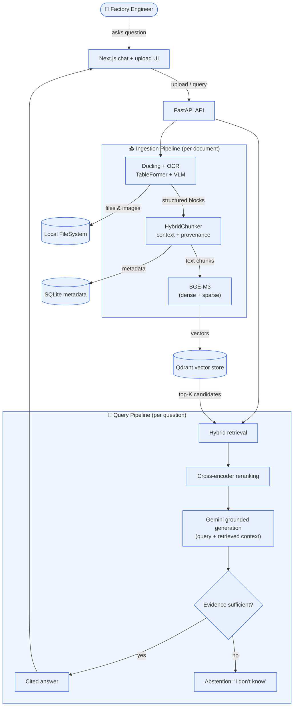
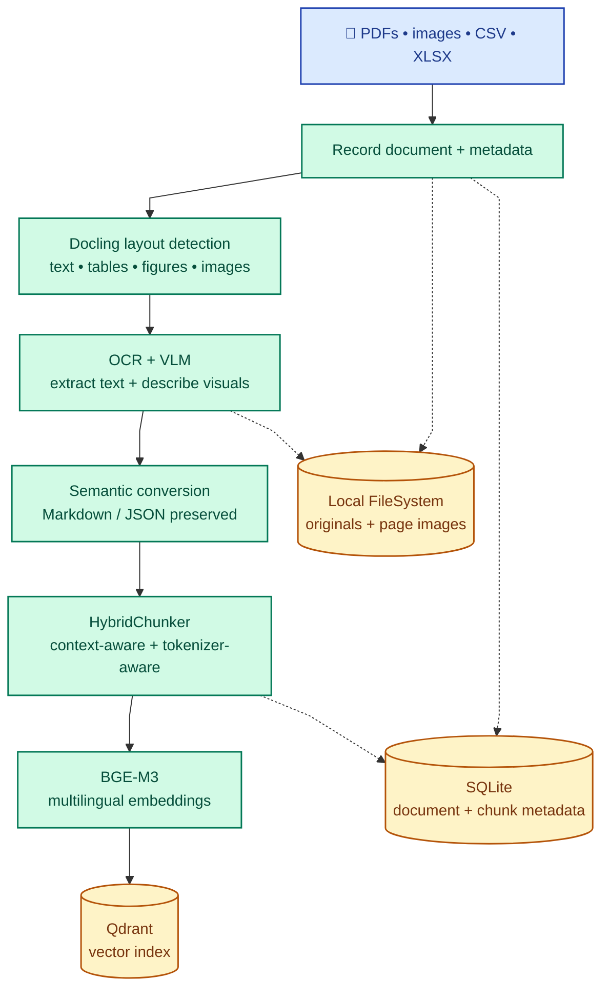
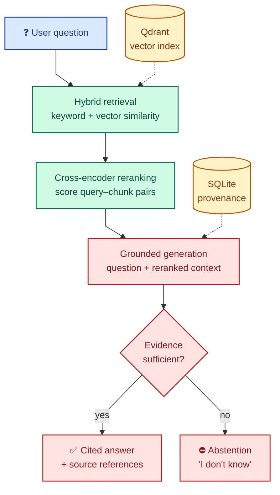

  

<h1 align="center">FORGE Factory Operations Retrieval &amp; Generation Engine</h1>

  <strong>Multimodal factory document intelligence for grounded, traceable answers.</strong> 
  Denso Factory Hackathon 2026 · Challenge A3

> **Dataset disclosure:** The supplied factory data-preparation/supply pack is **AI-generated synthetic data** for demonstration and evaluation only. It contains no official factory standard, confidential information, or production record.

FORGE is a multi-format document understanding and retrieval-augmented generation (RAG) system. It is designed to process PDFs, images, tables, and bilingual documents using OCR/VLM, layout-aware extraction, multilingual embeddings, and vector search - enabling accurate chatbot responses without manual preprocessing.

## Pain point

Factory operations knowledge is often spread across PDFs, scanned images, tables, and bilingual documents. Each format can require different preprocessing, including OCR, layout reconstruction, table extraction, and language handling, before an AI system can search and use the content. When that work is manual or inconsistent, valuable information takes longer to access and chatbot answers can miss or misread important context. This makes it difficult to build one dependable retrieval workflow for the documents teams already use.

## Unique selling point

FORGE is built around an evidence contract: document structure and provenance stay attached from page and region through chunk, retrieval, reranking, and citation. This lets one auditable pipeline handle text, tables, visuals, and bilingual evidence while measuring not only answer quality, but also whether the system should abstain. Its retrieval boundary is designed to support learned evidence-path routing without replacing the core pipeline.

## Data Curation

Input data is the foundation for validating the RAG system. To test every capability of the pipeline, the input corpus is curated from a diverse collection of open-source datasets, all licensed under permissive terms (Creative Commons, CC0, MIT, Apache 2.0, or public domain).

### Format Coverage

The corpus exercises every claimed input path through two linked sets:

**Coverage links**

- **Digital PDF** → Docling text extraction and reading order
- **Scanned PDF** → OCR and noisy-layout detection
- **PDF with complex tables** → TableFormer and table-aware chunking
- **PDF with charts or diagrams** → VLM adapter and image-block extraction
- **Bilingual PDF (VN/JP, VN/EN)** → BGE-M3 cross-lingual retrieval
- **Excel / CSV / XLSX** → structured parsing and row/column chunking
- **Standalone images** → VLM description and image understanding
- **Mixed PDF (text + table + image)** → structure parsing and multi-block handling

### Difficulty Tiers

Documents are stratified into six tiers for difficulty-specific reporting:

- **Tier 1 — Clean:** Digital PDF, single language, simple layout
- **Tier 2 — Structured:** Tables, headings, lists, nested sections
- **Tier 3 — Visual:** Charts, diagrams, embedded images
- **Tier 4 — Degraded:** Scanned, blurry, rotated, or low-resolution input
- **Tier 5 — Multilingual:** Bilingual or cross-lingual content
- **Tier 6 — Adversarial:** Missing pages, contradictory information, out-of-domain content

At least 60% of the corpus is Tier 2–5, ensuring FORGE is tested on realistic industrial complexity rather than only clean documents.

### Curation Principles

- **Open and licensed**: All documents are open-source or public domain, with clear attribution.
- **No PII or confidential content**: No personally identifiable information or proprietary Denso material.
- **Versioned and reproducible**: The corpus is tagged (e.g., `corpus_v1.0`) and referenced in every evaluation report.
- **Metadata-complete**: Each document carries a manifest record (format, tier, language, page count, source, license).
- **Bounded**: 10–20 documents, 80–200 pages total, enough for meaningful evaluation without exceeding 15 minutes per run.

## Solution architecture

FORGE uses a multimodal retrieval-augmented generation pipeline. The indexing path converts mixed-format documents into searchable, context-preserving representations. The answering path combines a user's question with the most relevant content and passes both to an LLM for a grounded response.

### Pipeline stages

#### Ingestion

#### Query

### Design principles

- **Layout-aware:** document structure is treated as part of the meaning, especially for tables, forms, and multi-column pages.
- **Multimodal:** the pipeline handles information found in text, images, and visual document elements.
- **Language-aware:** multilingual processing and embeddings support bilingual operational content.
- **Context-preserving:** tokenizer-aware chunking keeps related content together so retrieval does not lose the relationships created by the original layout.
- **Traceable:** each chunk retains source metadata so generated answers can be checked against the original document.

## Target deliverables

- Multi-format document ingestion pipeline
- RAG chatbot demonstration
- Retrieval, answer quality, and latency report
- Evaluation dashboard comparing a naive baseline with FORGE

## Technology stack

FORGE runs as native Python and Node.js processes or on managed services; Docker is optional.

| Layer | Technology | Purpose | Icon |
|---|---|---|:---:|
| Frontend | [Next.js](https://nextjs.org/docs/app) · React · TypeScript · Tailwind CSS | Chat UI and uploads |     |
| API | Python · [FastAPI](https://fastapi.tiangolo.com/) · Pydantic | Typed document and query contracts |    |
| Ingestion | [Docling](https://docling.org/) · OCR · `HybridChunker` | Layout-aware parsing and chunking |  |
| Embeddings | [BGE-M3](https://bge-model.com/bge/bge_m3.html) | Multilingual vector representations |  |
| Retrieval | [Qdrant](https://qdrant.tech/documentation/search/text-search/hybrid-search/) | Dense/sparse hybrid search and fusion |  |
| Reranking | [`bge-reranker-v2-m3`](https://huggingface.co/BAAI/bge-reranker-v2-m3) · CrossEncoder | Candidate reranking |  |
| Metadata | SQLite · PostgreSQL-ready | Documents, status, evaluation, and audit data |  |
| Storage | Local filesystem | Uploads and processed artifacts | — |
| Jobs | Python worker | Background ingestion and re-indexing |  |
| Generation | Gemini 2.5 Flash-Lite (free tier for demo) · `google-genai` | Grounded answer generation |  |
| Tooling | `uv` · `pnpm` | Python and Node.js dependencies |   |

## Evaluation framework

A reliable RAG system needs to be evaluated at every important boundary, from document extraction to the final answer. FORGE uses three pillars: a golden dataset, a consistent metric set, and repeatable evaluation tooling.

### 1. The golden dataset

The golden dataset is human-authored input included in each evaluation test case. Each case contains the question, source evidence, and expected answer; that expected answer is the ground truth used to evaluate retrieval, generation, correctness, and abstention.

### 2. The metrics

| **Metric** | **What it measures** | **Implementation** |
|---|---|---|
| **Hit@5** | Retrieval finds the right evidence | Python |
| **Context Recall** | Retrieval finds all needed evidence | Ragas |
| **Faithfulness** | LLM does not hallucinate | Ragas |
| **Answer Correctness** | Answers match ground truth | Ragas |
| **Answerability F1** | System abstains when it should | Python |
| **p95 Latency** | System is fast enough for production | Python |
| **Validation** | Regression checks and human calibration | Python |

Each run records the corpus, parser, chunker, embedding model, reranker, LLM, prompt, retrieval settings, and timestamp.

#### Cost accounting

These are demo estimates; production reporting should use the model, token, image, and infrastructure usage recorded for each run.

##### 1. Cost per query

| Assumption | Estimate |
|---|---:|
| Average input tokens (question + five chunks) | ~2,000 |
| Average output tokens | ~200 |
| Gemini Flash-Lite input price | $0.075 / 1M tokens |
| Gemini Flash-Lite output price | $0.30 / 1M tokens |

**Estimated cost per query** = `(2,000 × $0.075 + 200 × $0.30) / 1,000,000` = **$0.00021** (approximately **$0.0002**).

##### 2. Cost per document

When Docling, BGE-M3, Qdrant, and local storage run locally, ingestion is approximately **$0.00 per document**. Visual analysis is also free while it remains within the Gemini free tier; paid VLM usage makes the cost document-dependent.

##### 3. Monthly demo TCO

| Component | Monthly estimate |
|---|---:|
| Oracle Cloud VPS (Always Free) | $0 |
| Gemini API (10,000 queries) | $2.10 |
| Gemini visual analysis within free tier | $0 |
| Self-hosted services and local storage | $0 |
| **Estimated total** | **$2.10/month** |

The total excludes paid VLM overages, evaluation calls, and future managed-service costs.

### Baseline comparison

Run both systems on the same corpus and golden dataset:

- **Naive baseline:** fixed-size chunking, dense-only retrieval, no cross-encoder reranking, and the same generation model where possible.
- **FORGE:** Docling `HybridChunker`, hybrid dense and sparse retrieval, cross-encoder reranking, and the same generation model.

The results dashboard should show measured values and the change from baseline. Until the experiment is run, use `TBD` rather than presenting sample numbers as results.

| Category | Metric | Naive baseline | FORGE | Change |
|---|---|---:|---:|---:|
| Retrieval | Context recall | TBD | TBD | TBD |
| Retrieval | Reranker lift, MRR | N/A | TBD | TBD |
| Generation | Faithfulness | TBD | TBD | TBD |
| Generation | Answerability F1 | TBD | TBD | TBD |
| Operations | p95 latency | TBD | TBD | TBD |
| Operations | Cost per query | TBD | TBD | TBD |

## Repository Rules
1. Discuss ideas through Zalo first before building and sending a pull requests.
