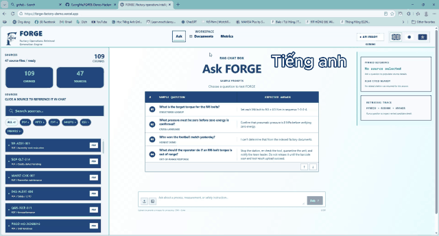

<p align="center">
  
</p>

<h1 align="center">FORGE: Factory Operations Retrieval &amp; Generation Engine</h1>

<p align="center">
  <strong>Multimodal factory document intelligence for grounded, traceable answers.</strong><br />
  Denso Factory Hackathon 2026 · Challenge A3
</p>

FORGE is a multi-format document understanding and retrieval-augmented generation (RAG) system. It is designed to process PDFs, images, tables, and bilingual documents using OCR/VLM, layout-aware extraction, multilingual embeddings, and vector search - enabling accurate chatbot responses without manual preprocessing.

## Product demo

<p align="center">
  
</p>

https://drive.google.com/drive/folders/1qdVDl9H-CoYMdPnjqeH863mENhnFoy40?usp=sharing

## Team UNICORN

* Team Member 1: Phan Tuấn Minh - Team Leader - Software Engineering Year 2
* Team Member 2: Phan Khánh Linh - UI/UX Design/Business Analyst - Data Science & AI Year 1
* Team Member 3: Nguyễn Tuấn Anh - Data Curator - Data Science & AI Year 2
* Team Member 4: Trần Hoàng Cường - Agile Developer - Data Science & AI Year 3 (Repo Owner)
* Team Member 5: Bùi Minh Tiến - Technical Specialist - Software Engineering Year 2

All team members contributed significantly to this project*
## SPECIAL NOTES

- **Frontend (`apps/web`):** The pilot interface is built with Next.js, React, TypeScript, and Tailwind CSS. It includes chat, document browsing, uploads, and metrics. The Vercel demo is a separate proof of concept that answers from a preprocessed corpus.
- **Backend (`services/api`):** The Python API uses FastAPI and Pydantic. Its implemented RAG pipeline uses Docling for document parsing and OCR, BGE-M3 for multilingual embeddings, Qdrant for hybrid retrieval, and a cross-encoder reranker. SQLite stores metadata; Gemini currently generates answers.
- **Current stage:** The pilot frontend and core backend pipeline are implemented and under testing. The backend still depends on the Gemini API for answer generation, so it is not fully offline, not fine-tuned or even running properly but the skeleton is set. Packaging and validation for factory deployment remain ahead.

## Pain point

Factory teams often spend too long gathering information across departments. Relevant details are scattered across PDFs, Word and Excel files, and scanned documents, with tables and images embedded inside them. Vietnamese, English, and Japanese content can also be difficult to compare, making it easier to miss information or lose context when answering a question.

## Unique selling point

1. FORGE is being fine-tuned for factory environments and aiming for seamless integration with DensoGPT.
2. Its local-first full-stack design keeps hosting costs close to zero.
3. FORGE is a hardened RAG pipeline engineered for production reliability. Checkpointed ingestion, retries, and idempotent writes prevent data loss and duplication. Being fully self-hosted, it also preserves data privacy — no factory documents leave the premises.

## Data Curation

The project uses three datasets: a multilingual golden set, curated external test data, and an AI-generated factory pack.

| Dataset | Contents and purpose |
|---|---|
| **Golden dataset** | [`golden_dataset_25_multilingual.csv`](data/evaluation/golden_dataset_25_multilingual.csv): 25 factory questions with expected answers (15 Vietnamese, 5 Japanese, 5 English), ready for recording answers and review. |
| **Curated data** | 30 [JA-Business-Doc-RQ-Bench](https://huggingface.co/datasets/stockmark/JA-Business-Doc-RQ-Bench) images with Q&A metadata, plus 30 [Screw Dataset](https://huggingface.co/datasets/shrish23/screw-dataset) image-mask pairs (five per class, CC BY 4.0). The screw images and masks are stored in [`images/screw_dataset`](data/curated_forge_testing/images/screw_dataset) and [`ground_truth/screw_dataset`](data/curated_forge_testing/ground_truth/screw_dataset). |
| **AI-generated pack** | [`data/denso_factory_hack_data_prep`](data/denso_factory_hack_data_prep): synthetic factory PDFs, scans, images, spreadsheets, and CSVs for testing ingestion, OCR, visual analysis, retrieval, and UI flows. |

* The VIXIO dataset was dropped because it is not licensed for open distribution.

### Curation Principles

1. **Preserve provenance:** Keep each sample linked to its original source, dataset, metadata, and with proper open-source license.
2. **Cover factory formats:** Include documents, scans, tables, images, CSV/XLS/XLSX, PowerPoint, and TXT files, plus bilingual Vietnamese/Japanese content.
3. **Separate test purposes:** Use the golden dataset for answer evaluation, curated data for repeatable external-source tests, and the AI-generated pack for functionality testing.

## Market Research & Analysis

FORGE sits between managed enterprise search, open-source document-RAG platforms, and industrial copilots. The alternatives below are adjacent rather than identical competitors:

| Alternative | Current strength | FORGE's position |
|---|---|---|
| [Azure AI Search](https://learn.microsoft.com/en-us/azure/search/retrieval-augmented-generation-overview?tabs=docs) | Managed hybrid retrieval, semantic ranking, agentic retrieval, and multimodal document extraction. | A smaller, local-first factory pipeline with direct control over parsing, models, and evidence policy. |
| [Amazon Bedrock Knowledge Bases](https://docs.aws.amazon.com/bedrock/latest/userguide/kb-multimodal.html) | Managed multimodal ingestion and retrieval across text, images, audio, and video. | Focused on the factory document formats and bilingual evidence flows needed for the A3 demo. |
| [Google Agent Search](https://docs.cloud.google.com/generative-ai-app-builder/docs) | Managed enterprise search, semantic understanding, structured data, PDFs, and generated answers. | Lower-cost, self-hostable architecture with an explicit ingestion trace and abstention path. |

### Positioning

FORGE positioned as a practical factory-document intelligence layer: local-first, multimodal, bilingual, source-cited, and safe to abstain when evidence is weak. 

### Related research

- **10. Lewis et al. (2020) — RAG, NeurIPS:** [paper](https://proceedings.neurips.cc/paper/2020/hash/6b493230205f780e1bc26945df7481e5-Abstract.html)
- **11. Es et al. (2024) — RAGAS, EACL:** [paper](https://aclanthology.org/2024.eacl-demo.16/)

The main gaps versus mature enterprise products are connectors, identity-aware permissions, high-availability workers, and measured benchmark results. These should be framed as the next production milestones rather than hidden behind generic RAG claims.

## Solution architecture

FORGE uses a multimodal retrieval-augmented generation pipeline. The indexing path converts mixed-format documents into searchable, context-preserving representations. The answering path combines a user's question with the most relevant content and passes both to an LLM for a grounded response.

The pilot can index ASCII DXF blueprints, including labels, layers, dimension values, and common 2D geometry. Export DWG files as ASCII DXF before upload; direct DWG, binary DXF, and visual drawing interpretation are not supported yet.


### Vercel demo

Live demo: [https://forge-factory-demo.vercel.app](https://forge-factory-demo.vercel.app/)

Run it locally from Git:

```sh
git clone https://github.com/CuongMe/FORGE-Denso-Hackathon-Team-UNICORN-BUV-ongoing.git
cd FORGE-Denso-Hackathon-Team-UNICORN-BUV-ongoing/apps/web
cp .env.vercel.example .env.local
pnpm install
pnpm dev
```

Set `GEMINI_API_KEY` in `.env.local` to enable live Gemini answers; Upstash credentials are only needed when deployed. The demo uses a preprocessed corpus and BM25 retrieval, separate from the system backend in `services/`.

### Design principles

- **Layout-aware:** document structure is treated as part of the meaning, especially for tables, forms, and multi-column pages.
- **Multimodal:** the pipeline handles information found in text, images, and visual document elements.
- **Language-aware:** multilingual processing and embeddings support bilingual operational content.
- **Context-preserving:** tokenizer-aware chunking keeps related content together so retrieval does not lose the relationships created by the original layout.
- **Traceable:** each chunk retains source metadata so generated answers can be checked against the original document.

## Target deliverables

- Multi-format document ingestion pipeline
- RAG chatbot demonstration
- Retrieval, answer quality, and latency report
- Evaluation dashboard comparing a naive baseline with FORGE

## Technology stack

FORGE runs as native Python and Node.js processes or on managed services; Docker is optional.

| Layer | Technology | Purpose | Icon |
|---|---|---|:---:|
| Frontend | [Next.js](https://nextjs.org/docs/app) · React · TypeScript · Tailwind CSS | Chat UI and uploads |     |
| API | Python · [FastAPI](https://fastapi.tiangolo.com/) · Pydantic | Typed document and query contracts |    |
| Ingestion | [Docling](https://docling.org/) · OCR · `HybridChunker` | Layout-aware parsing and chunking |  |
| Visual understanding | [Florence-2](https://huggingface.co/microsoft/Florence-2-base-ft) | Local visual captions with human review |  |
| Embeddings | [BGE-M3](https://bge-model.com/bge/bge_m3.html) | Multilingual vector representations |  |
| Retrieval | [Qdrant](https://qdrant.tech/documentation/search/text-search/hybrid-search/) (self-hosted) | Dense/sparse hybrid search and fusion |  |
| Reranking | [`bge-reranker-v2-m3`](https://huggingface.co/BAAI/bge-reranker-v2-m3) · CrossEncoder | Candidate reranking |  |
| Metadata | SQLite · PostgreSQL-ready | Documents, status, evaluation, and audit data |  |
| Storage | Local filesystem | Uploads and processed artifacts | — |
| Jobs | Python worker | Background ingestion and re-indexing |  |
| Generation | Configurable Gemini model · `google-genai` | Grounded answer generation |  |
| Tooling | `uv` · `pnpm` | Python and Node.js dependencies |   |

## Evaluation framework

A reliable RAG system needs to be evaluated at every important boundary, from document extraction to the final answer. FORGE includes a manual multilingual test set for checking its factory-document retrieval and answers.

### Manual multilingual test set

[`golden_dataset_25_multilingual.csv`](data/evaluation/golden_dataset_25_multilingual.csv) contains 25 source-backed questions: 15 Vietnamese, 5 Japanese, and 5 English. It includes expected answers and blank fields for recorded answers, review checkboxes, and notes. The corpus is synthetic demo data, not official DENSO operational data.

### 2. The metrics

| **Metric** | **What it measures** | **Implementation** |
|---|---|---|
| **Hit@5** | Retrieval finds the right evidence | Python |
| **Context Recall** | Retrieval finds all needed evidence | Ragas |
| **Faithfulness** | LLM does not hallucinate | Ragas |
| **Answer Correctness** | Answers match ground truth | Ragas |
| **Answerability F1** | System abstains when it should | Python |
| **p95 Latency** | System is fast enough for production | Python |
| **p50 Latency** | Median end-to-end response time | Python |

Each run records the corpus, parser, chunker, embedding model, reranker, LLM, prompt, retrieval settings, and timestamp.

#### Cost accounting

**Self-hosted estimate (USD), assuming an existing factory server:**


With existing hardware, budget for electricity and any hardware amortization; the software licence cost is $0.

### License

This project is licensed under the [Apache License 2.0](LICENSE).

### Baseline comparison

Compare both systems on the same reviewed answerable question set:

- **Naive baseline:** fixed-size chunking, dense-only retrieval, no cross-encoder reranking, and the same generation model where possible.
- **FORGE:** Docling `HybridChunker`, hybrid dense and sparse retrieval, cross-encoder reranking, and the same generation model.

The current abstention holdout cannot support this comparison. Use `TBD` until a reviewed answerable question set is available and the experiment is run.

| Category | Metric | baseline | FORGE | Change |
|---|---|---:|---:|---:|
| Retrieval | Context recall | TBD | TBD | TBD |
| Retrieval | Reranker lift, MRR | N/A | TBD | TBD |
| Generation | Faithfulness | TBD | TBD | TBD |
| Generation | Answerability F1 | TBD | TBD | TBD |
| Operations | p95 latency | TBD | TBD | TBD |
| Operations | Cost per query | TBD | TBD | TBD |

## What’s Done and What’s Next

| Status | Work |
|---|---|
| **Done ✓** | Built the pilot API and web interface for document ingestion, browsing, and question answering. |
| **Done ✓** | Added layout-aware, multimodal document processing and multilingual retrieval for English, Japanese, and Vietnamese. |
| **Done ✓** | Implemented hybrid retrieval, reranking, source citations, and abstention when evidence is insufficient. |
| **Next** | Complete the backend pipeline and integrate it with the frontend before pilot testing. |
| **Next** | Fine-tune Florence-2: prepare the dataset, run two LoRA training rounds, and export the model. |
| **Next** | Optimize the system with payload indexing, HNSW tuning, and monitoring. |
| **Next** | Evaluate p50/p95 latency, faithfulness, context recall, and IoU for visual grounding. |
| **Next** | Explore semantic caching and quantization, and add regression tests. Run this work in parallel so it does not delay the pilot. |
| **Next** | Run the pilot and finalize the results. |
| **Next** | Benchmark p50/p95 latency and throughput on the intended offline hardware using realistic data sizes. |
| **Next** | Validate the DENSO pilot and finalize production requirements, including access control, monitoring, backups, and deployment procedures. |

## Fine-tune Dataset Definition for Florence-2 (Labeling Plan)
This section defines how factory images will be selected, labeled, and reviewed to build a consistent Florence-2 fine-tuning dataset for visual inspection and image understanding.